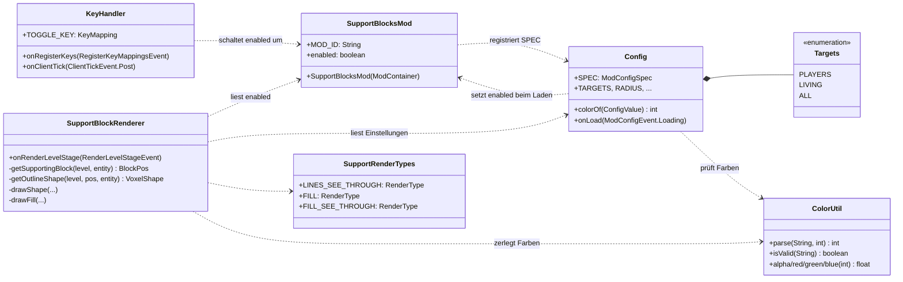
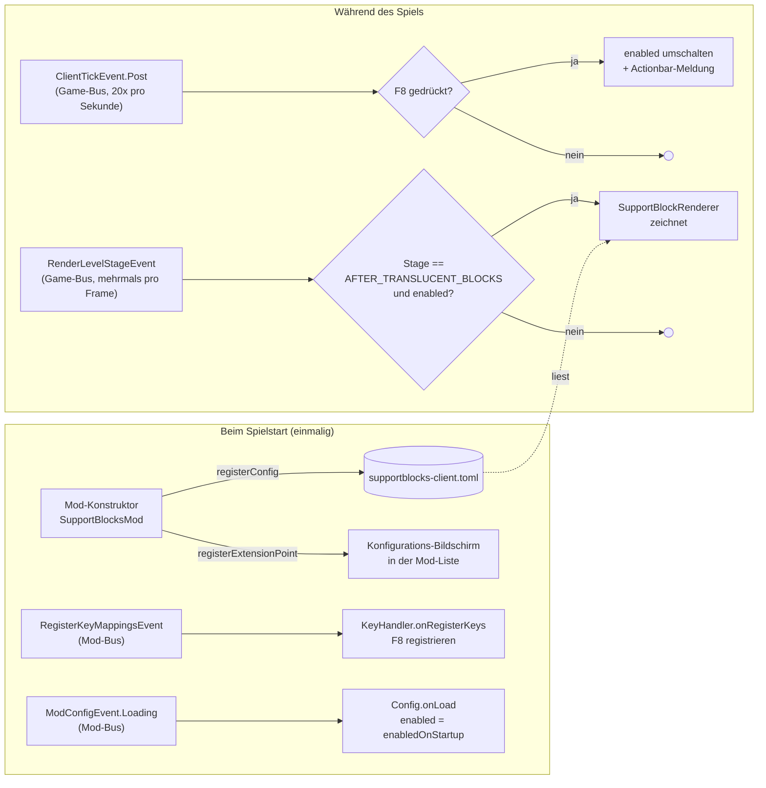
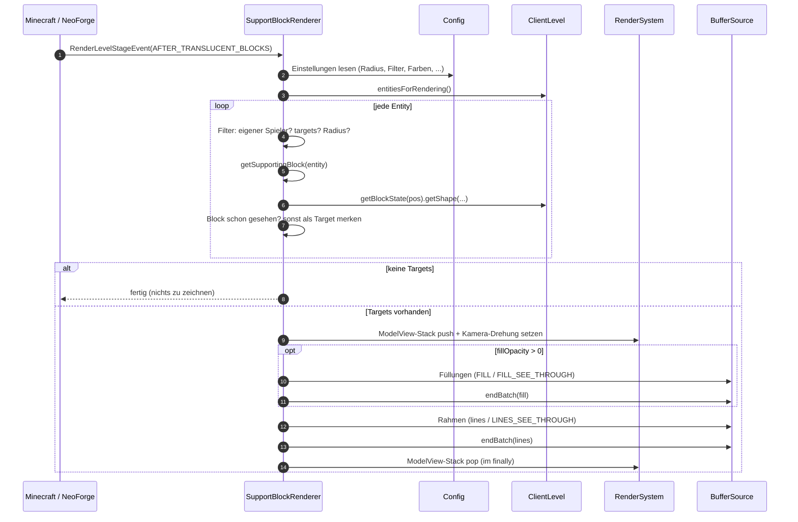
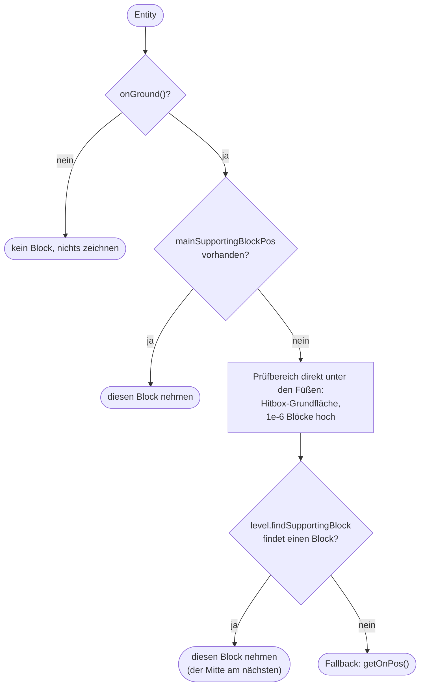
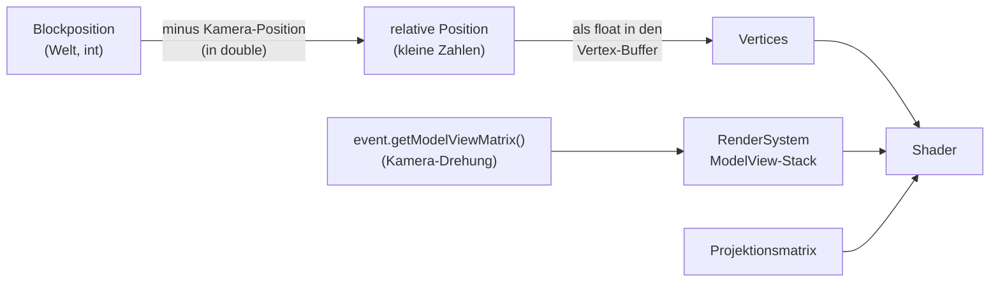
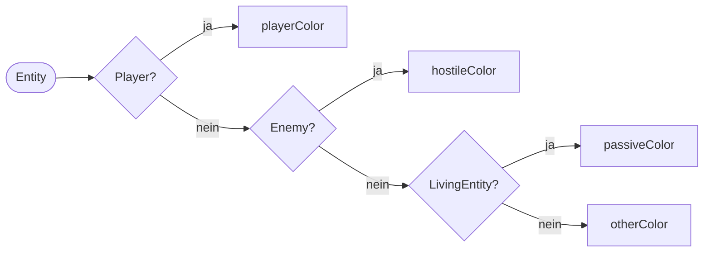
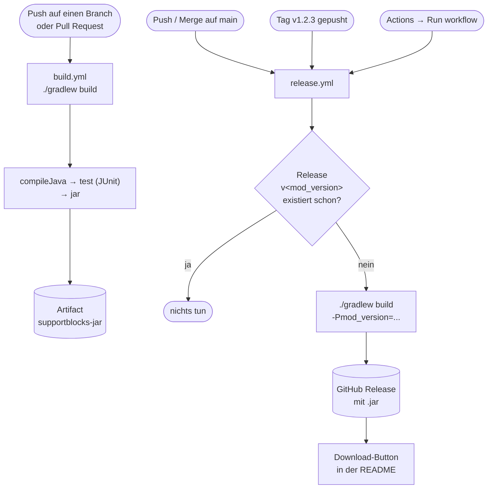

# Support Blocks – Architektur und Dokumentation

Diese Seite beschreibt, wie die Mod aufgebaut ist, was pro Frame passiert und wie Build,
Tests und Releases funktionieren. Die Diagramme sind Mermaid-Grafiken und werden auf
GitHub direkt angezeigt.

- [Überblick](#überblick)
- [Klassen und Zuständigkeiten](#klassen-und-zuständigkeiten)
- [Event-Fluss](#event-fluss)
- [Ablauf pro Frame](#ablauf-pro-frame)
- [Wie der Support-Block bestimmt wird](#wie-der-support-block-bestimmt-wird)
- [Zeichnen: Koordinaten und Matrizen](#zeichnen-koordinaten-und-matrizen)
- [Render-Typen](#render-typen)
- [Konfiguration](#konfiguration)
- [Projektstruktur](#projektstruktur)
- [Build, Tests und Releases](#build-tests-und-releases)
- [Bekannte Grenzen](#bekannte-grenzen)

## Überblick

| | |
|---|---|
| Minecraft | 1.21.1 |
| Mod-Loader | NeoForge 21.1.258 (FancyModLoader 4.x) |
| Java | 21 |
| Build | Gradle 8.14.3 mit ModDevGradle 2.0.115 |
| Mod-ID | `supportblocks` |
| Seite | nur Client (`@Mod(dist = Dist.CLIENT)`) |
| Lizenz | GPL-3.0-or-later |

Die Mod baut den Debug-Renderer `visualize_entity_supporting_block` aus Minecraft 1.21.11
nach: Unter jeder Entity wird der Block markiert, auf dem sie steht. Weil die Mod die
Entities selbst durchläuft und nicht über deren Modell zeichnet, funktioniert das auch bei
unsichtbaren Entities.

## Klassen und Zuständigkeiten



| Klasse | Aufgabe |
|---|---|
| `SupportBlocksMod` | Einstiegspunkt. Registriert die Client-Config und den Konfigurations-Knopf in der Mod-Liste. Hält den An/Aus-Zustand `enabled`. |
| `KeyHandler` | Registriert die Taste (Standard **F8**) und schaltet nach jedem Client-Tick um. Zeigt „Support-Blöcke: AN/AUS“ in der Actionbar. |
| `Config` | Alle Einstellungen als `ModConfigSpec` (Datei `config/supportblocks-client.toml`). Übernimmt beim ersten Laden `enabledOnStartup`. |
| `SupportBlockRenderer` | Das Herzstück: sucht pro Frame die Support-Blöcke und zeichnet Füllung und Rahmen. |
| `SupportRenderTypes` | Eigene Render-Typen: Linien ohne Tiefentest sowie Füllungen mit und ohne Tiefentest. |
| `ColorUtil` | Liest Hex-Farben (`#RRGGBB` / `#AARRGGBB`). Ohne Minecraft-Abhängigkeit, deshalb mit JUnit getestet. |

## Event-Fluss

Alle Handler melden sich per `@EventBusSubscriber` an. FancyModLoader ordnet jede Methode
anhand des Event-Typs automatisch dem richtigen Bus zu: Events, die `IModBusEvent`
implementieren, landen auf dem Mod-Bus, alle anderen auf dem Game-Bus.



## Ablauf pro Frame



Die Stage `AFTER_TRANSLUCENT_BLOCKS` wurde gewählt, damit Wasser und Glas, die in dieser
Phase gezeichnet werden, die Rahmen nicht nachträglich überdecken.

## Wie der Support-Block bestimmt wird



**Warum drei Stufen?**

1. `mainSupportingBlockPos` ist das Feld, das Vanilla selbst pflegt. Auf dem Client
   aktualisiert Minecraft es aber nur für Entities, die der Client selbst bewegt: den
   eigenen Spieler, Items oder Pfeile.
2. Für Mobs und andere Spieler rechnet die Mod es deshalb genauso nach wie Vanilla in
   `Entity#checkSupportingBlock`. Dadurch stimmt der Block auch, wenn eine Entity an einer
   Kante zwischen zwei Blöcken steht.
3. `getOnPos()` ist der letzte Ausweg, z. B. wenn die Hitbox nichts berührt, die Entity
   laut Server aber am Boden ist.

Das `onGround()` wird **zuerst** geprüft, weil `mainSupportingBlockPos` nicht bei jeder
Entity zuverlässig geleert wird.

## Zeichnen: Koordinaten und Matrizen



Zwei Details sind wichtig:

- **Relativ zur Kamera rechnen:** Die Verschiebung um die Kamera passiert in `double`,
  bevor die Werte zu `float` werden. Würde man absolute Weltkoordinaten als `float`
  übergeben, würden die Rahmen weit weg vom Spawn (z. B. x = 100 000) sichtbar zittern.
- **Kamera-Drehung selbst setzen:** In dieser Stage übergibt NeoForge einen leeren
  PoseStack, und die globale Model-View-Matrix enthält die Drehung je nach Stelle nicht
  mehr. Der Renderer setzt sie deshalb aus `event.getModelViewMatrix()` und stellt den
  alten Zustand in einem `finally`-Block wieder her.

Gezeichnet werden alle Kanten der Blockform (`VoxelShape#forAllEdges`), also bei einer Stufe
nur die halbe Höhe. Die Füllung besteht aus den Teilquadern der Form (`toAabbs()`) und ist
0,002 Blöcke größer als der Block, damit sie nicht mit der Oberfläche flackert.

## Render-Typen

| Render-Typ | Primitive | Tiefentest | Verwendung |
|---|---|---|---|
| `RenderType.lines()` (Vanilla) | Linien | ja | Rahmen, normal |
| `LINES_SEE_THROUGH` | Linien | **nein** | Rahmen mit `seeThroughWalls = true` |
| `FILL` | Triangle-Strip | ja | Füllung, normal |
| `FILL_SEE_THROUGH` | Triangle-Strip | **nein** | Füllung mit `seeThroughWalls = true` |

Alle eigenen Typen schreiben nur Farbe und keine Tiefe (`COLOR_WRITE`), verwenden
Transparenz und `VIEW_OFFSET_Z_LAYERING`, das die Geometrie leicht zur Kamera hin
verschiebt. Möglich ist das, weil NeoForge `RenderType.create` und die `RenderStateShard`-
Felder per Access-Transformer öffentlich macht.

## Konfiguration

Datei: `.minecraft/config/supportblocks-client.toml`. Im Spiel änderbar über
*Mods → Support Blocks → Konfiguration*. Änderungen wirken sofort, weil der Renderer die
Werte in jedem Frame liest.

| Option | Typ | Standard | Bereich / Werte |
|---|---|---|---|
| `enabledOnStartup` | Boolean | `false` | Overlay beim Start an |
| `targets` | Enum | `ALL` | `PLAYERS`, `LIVING`, `ALL` |
| `includeSelf` | Boolean | `false` | eigener Spieler, nur in Third Person |
| `radius` | Int | `64` | 1 – 256 Blöcke |
| `seeThroughWalls` | Boolean | `false` | durch Wände sichtbar |
| `useBlockShape` | Boolean | `true` | echte Form statt Würfel |
| `fillOpacity` | Double | `0.0` | 0.0 – 1.0 |
| `playerColor` | Hex | `#00FF00` | Spieler |
| `hostileColor` | Hex | `#00FF00` | feindliche Mobs (`Enemy`) |
| `passiveColor` | Hex | `#00FF00` | übrige `LivingEntity` |
| `otherColor` | Hex | `#00FF00` | alles andere |

So wird die Farbe einer Entity bestimmt:



## Projektstruktur

```
Debug-Render-Minecraft-/
├── .github/workflows/
│   ├── build.yml            # baut bei jedem Push / PR, lädt die .jar als Artifact hoch
│   └── release.yml          # erstellt Releases mit der .jar
├── docs/
│   └── ARCHITEKTUR.md       # diese Seite
├── gradle/wrapper/          # Gradle 8.14.3
├── src/
│   ├── main/
│   │   ├── java/com/supportblocks/
│   │   │   ├── SupportBlocksMod.java
│   │   │   ├── KeyHandler.java
│   │   │   ├── Config.java
│   │   │   ├── SupportBlockRenderer.java
│   │   │   ├── SupportRenderTypes.java
│   │   │   └── ColorUtil.java
│   │   └── resources/
│   │       ├── META-INF/neoforge.mods.toml
│   │       ├── assets/supportblocks/lang/{de_de,en_us}.json
│   │       └── pack.mcmeta
│   └── test/java/com/supportblocks/
│       └── ColorUtilTest.java
├── build.gradle
├── gradle.properties        # Versionen (Minecraft, NeoForge, mod_version)
├── settings.gradle
├── CHANGELOG.md
├── LICENSE                  # GPL-3.0
└── README.md
```

## Build, Tests und Releases



- **Lokal bauen:** `./gradlew build`, die Mod liegt danach in `build/libs/`.
  `./gradlew test` führt nur die Unit-Tests aus. Benötigt JDK 21.
- **Im Spiel testen (Entwicklung):** `./gradlew runClient` startet Minecraft mit der Mod.
- **Neue Version:** `mod_version` in `gradle.properties` erhöhen und auf `main` pushen.
- Die Mod-Version in `neoforge.mods.toml` kommt über `${file.jarVersion}` aus dem
  `Implementation-Version`-Eintrag im Jar-Manifest.

## Bekannte Grenzen

- **Im Spiel noch nicht getestet:** Der Code baut und die Unit-Tests laufen. Die Darstellung
  (Position der Rahmen, Durch-Wände-Modus, Füllung) muss noch im Spiel geprüft werden.
- **Fremde Entities:** Ob eine fremde Entity am Boden ist, weiß der Client nur aus den
  Bewegungspaketen des Servers. Bei starker Verzögerung kann der Rahmen kurz hinterherhinken.
- **Nur Rendering:** Die Mod verändert nichts am Spielgeschehen und sendet nichts an den
  Server.
